# Introduction

Here's some instructions for getting ready for the Showciety Gives Back 2026 charity event benefitting The Trevor Project! These instructions are geared towards Windows builds of OBS Studio. They will likely work on other Operating Systems, but may not line up exactly. We also provide some limited instructions for using SLOBS. We will do our best to help if you post your issues in [#sgb26-troubleshooting](https://discord.com/channels/475693157720522752/1549284772923179128) no matter what operating system or streaming software you use!

# Indirect donations

To ensure absolute transparency with our viewers, to instill trust with our charity partners, and to avoid unnecessary costs and undue expectations of our streamers, the Super Mario Showciety Mod team has decided that all Streamers moving forward will only accept donations during charity events via the Tiltify platform for the event. At no time should streamers be handling funds that are meant for our charity partners, this means that streamers shall not encourage their viewers to donate to the charity via bits, subs, or tipping to their channel. If you have any questions, please do not hesitate to reach out to a moderator via a ping or DM.

# Set-Up

## Early Setup

These steps can be done early and should not affect your regular streams.

1. Set up OBS for the event. See "[Stream Setup](#stream-setup)". Since this is a separate scene collection it shouldn't impact your regular streams. You may have your own flourish, but we would like to try to have a generally consistent "look" for the event so please keep that in mind. See "[Streamlabs OBS (SLOBS) Notes](#streamlabs-obs-slobs-notes)" if you use SLOBS. Ping @Mod to test the charity alerts.
2. Make a Tiltify account (or login with Twitch) and request to be part of the team on Tiltify. Once logged in go to the [Super Mario Showciety Team Page](https://tiltify.com/+super-mario-showciety/profile) to request an invite. There is a black "Join team +" button next to the "Super Mario Showciety on Tiltify" header at the top!
3. While **NOT** required we recommend planning donation incentives. See "[Donation Incentive Ideas](#donation-incentive-ideas)".
4. Get to know a little about the charity we're supporting so you can talk it up. See "[Talking Points](#talking-points)" if you need something to get the juices flowing, but you should try to know a few things that the talking points can refresh in your mind's eye.
5. Get to know the people before and after your slot so that you can welcome/introduce them.
6. Get to know your coordinator a little!
7. Please remember your time slot, show up on time and finish on time as a courtesy to the other streamers before and after your event.
8. Set up [Twitch Panels](#twitch-panels) (this may be done closer to the event if you are using an image and linking directly to https://showciety.gives/, or changed from the campaign link to the donation link closer to the event) - up to your preference what you wish to do. (OPTIONAL)

## Late Setup

You will most likely want to do these steps close to your charity stream slot as they may interrupt your regular streams.

1. Remove any charity or donation links in your bot commands, profile, panels, etc... that are not related to the charity we're fundraising for. If you don't do this someone will get confused and donate to the wrong charity or accidentally send you money instead of the charity.
2. Set up bot commands for the links to the charity, donation page, etc. (see "[Bot Commands](#bot-commands)"). Optionally set up timers to periodically post the same messages automatically. Make sure there are no conflicting commands - especially for !donate and !charity! (Having a !tip command for sending you money personally is fine as long as you're not accepting money for the charity)
3. Update your panel with the direct donation link. (OPTIONAL)

# OBS Studio Setup

Download the [latest release](https://github.com/Showciety/SGB/releases/latest) 'Source Code (zip)' from our github. This zip file contains the scene collection "SGB26.json" (for import into OBS), image assets, the font used for the text sources, music assets and anything else you may need. The assumed canvas size is 1920x1080. If you would like to use a 1280x720 canvas size you will need to make your own modifications or use a 1080p canvas and rescale stream/output resolution to 720p.

## Install Font

Before opening OBS Studio make sure to right click the SMM2 font "super-mario-maker-2.ttf" and click "Install". If it's not showing up try restarting OBS.

## Importing Scene Collection

To simplify the setup we've included an exported scene collection (`SGB26.json`). To use this in OBS Studio click "Scene Collection" in the top menu, click Import, the import dialogue should open, click the three dots in the "Collection Path" box, select the JSON file and click the "Import" button.

## Finding Missing Files

Once you import the scene collection you can then click on "Scene Collection" in the top bar and select "SGB26" to load the scene collection (do not do this live as OBS may crash). You will get a dialogue titled "Missing Files" to point OBS to the location all the image and audio assets are stored. Since we've put all the files necessary in this zip file you just have to click "Search Directory..." and browse to where you extracted this to. Once all the files have a file path listed in the "New File" column you can click "Apply". Depending on your version you may have to do this for the Music sub-folder as well - newer versions do not traverse subdirectories.

## Required Customizations

We have created six "Live" scenes called "Live 16:9 Left Scene", "Live 16:9 Right Scene", "Live 8:7 Left Scene", "Live 8:7 Right Scene", "Live 4:3 Left Scene" and "Live 4:3 Right Scene" for 16:9, 8:7 (i.e. SNES Emulator) and 4:3 (i.e. SNES hardware) games with the game on the left or right according to your preference. You can remove ones you don't plan on using and optionally rename the remaining one(s) (e.g. Naming the one scene you plan on using simply "Live Scene").

You will need to edit the sources to change text, match your devices, use your preferred device settings or add your preferred filters (e.g. Cropping, Chroma Key or audio filters like compressor, expander, etc...) to some degree. The amount you need to change will vary on your setup.

We have added multiple types of video/audio sources with adequate transforms applied for ease of use and you **will not** require ALL of them as there are conflicting sources (e.g. "Desktop Audio Source" and "Game Audio Source"). Make sure to remove conflicting sources or you will have issues. You will need to modify some of the sources you do use at least a little bit such as setting your device, device settings, cropping your camera, adding chroma key, adding an audio compressor filter, etc... We won't cover the specifics here other than to say you might need to edit it.

Sources you will likely need to edit, remove or hide:
* Link Source (e.g. if you're doing Crowd Control and want people to donate that way it can be removed / hidden)
* Commands 4:3 Source, Commands 8:7 Source, Commands 16:9 Source (if you are not having incentives you may remove !incentives)
* Streamer Name Source
* Pronouns Source
* Game Name Source
* Game Name 2 Source
* Webcam Source
* Game Capture Source
* Display Capture Source
* Capture Card Source
* Desktop Audio Source
* Game Audio Source
* Mic Source
* Crowd Control 16:9 Overlay Source
* Crowd Control 8:7 Overlay Source
* Crowd Control 4:3 Overlay Source

You will also need to go into Edit > "Advanced Audio Properties" and set the "Audio Monitoring" and "Tracks" columns to work with your audio setup. We've preset these with some settings that may work for you, but you are responsible for ensuring they work properly.

Depending on your setup you may need to add your own sources and/or remove all of ours. There are too many combinations to list for a general guide.

We will try to help if you're having trouble in [#sgb26-troubleshooting](https://discord.com/channels/475693157720522752/1549284772923179128) for specific setups.

## Suggested Optional Customizations

You are not limited to ONLY these changes! These are only ideas to use as a jumping off point.

* Resize the game to fit the game area. We've added a transform to the game sources that tries to do a good job of doing this, but it may not meet your needs. For example several emulators produce an image that is 1 pixel off the correct aspect ratio when not in full screen and Minecraft is one pixel too tall (1920x1081) when windowed for some reason. Feel free to modify them or delete them and add your own. NOTE: SLOBS does not import the transform so this will likely be required if you use SLOBS.
* Updating the "Streamer Alert Source" with your own alert URL
* Crop/Resize your camera, add any filters you need, etc...
* Add audio filters to sources
* Change "frame" and/or background images (we have provided a TON of colour variations).
* Change starting / BRB / ending music. We have provided several audio files to choose from, but you may use your own choice of royalty-free music or set up your own custom scenes
* Transitions
* Picture/Rig to put in place of camera for non-camera strimmers
* Advanced audio properties track setup. You may need different audio to go to different tracks depending on your stream / recording setup (e.g. VOD track)
* Change or update background music
* Customize Crowd Control Overlay colour scheme / theme
* Text outline colours (there is a list of colours in `palette.txt`)
* Chat overlay (optional)
* Subtitles (optional)

## Source Copy Plugin

You may find the [Source Copy Plugin](https://obsproject.com/forum/resources/source-copy.1261/) useful to copy sources from your normal scene collection to the SGB scene collection.

## Finalization

Do a test recording or stream, try all the scenes, test your alerts, test your chat commands, speak a bit and try to play the game to make sure audio is working correctly! Ping an @Mod to send a test donation alert. Make sure the audio is working correctly.

After a test recording or stream run your OBS log through the [OBS Log Analyzer](https://obsproject.com/tools/analyzer) to highlight any issues!

### Please create a thread and ping "@SGB26 Planning Team" with a screenshot or recording of any scenes you plan to use in [#sgb26-overlay-approval](https://discord.com/channels/475693157720522752/1562688927503097866) and someone from the planning team will give it a once-over, let you know if there are any issues or approve it once it looks good.

## Examples

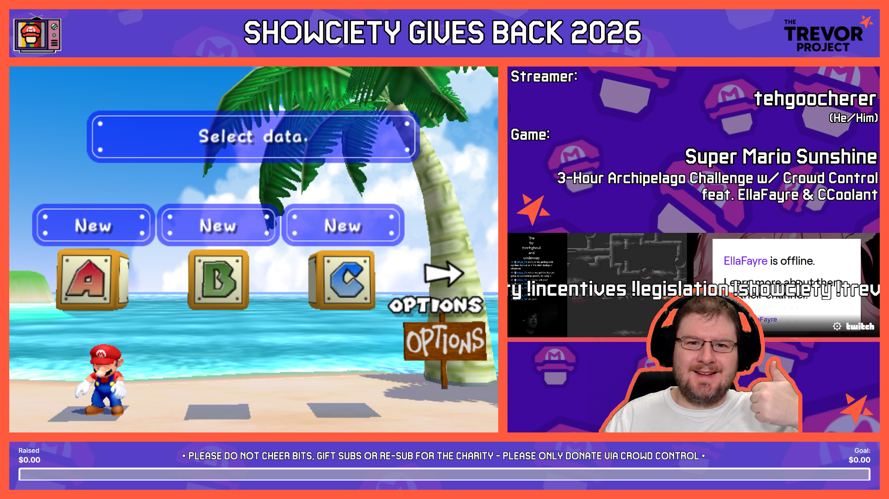
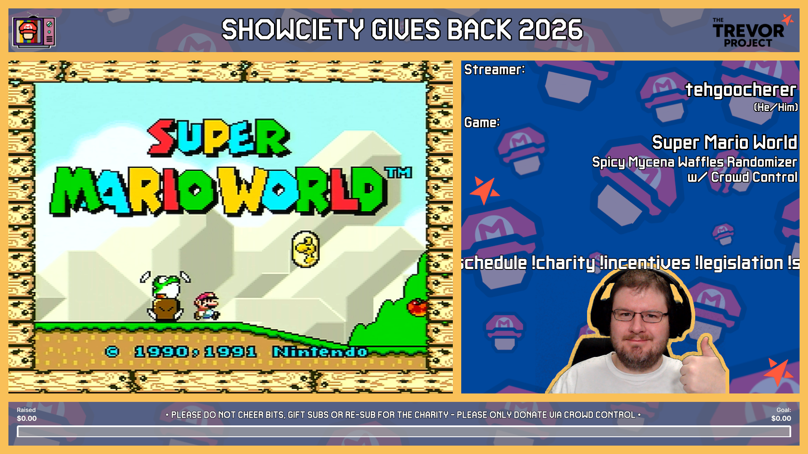
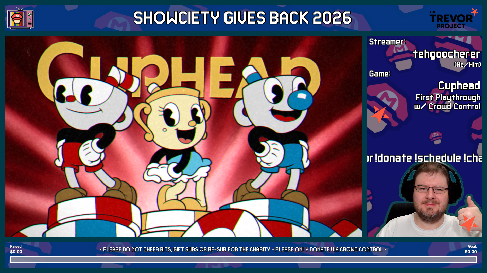
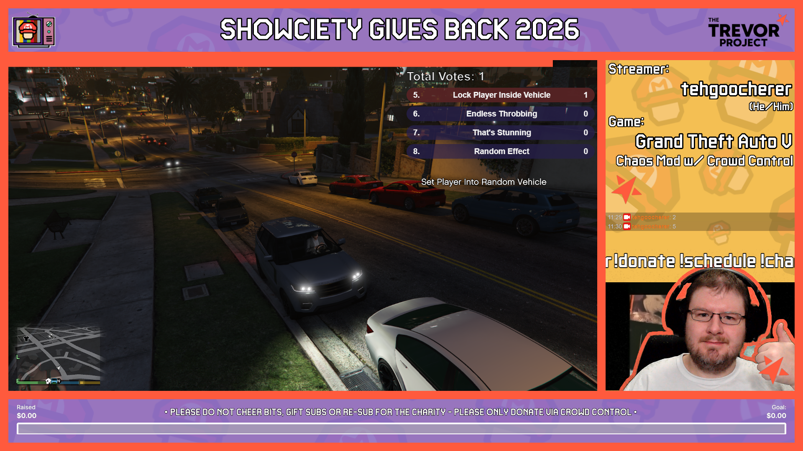
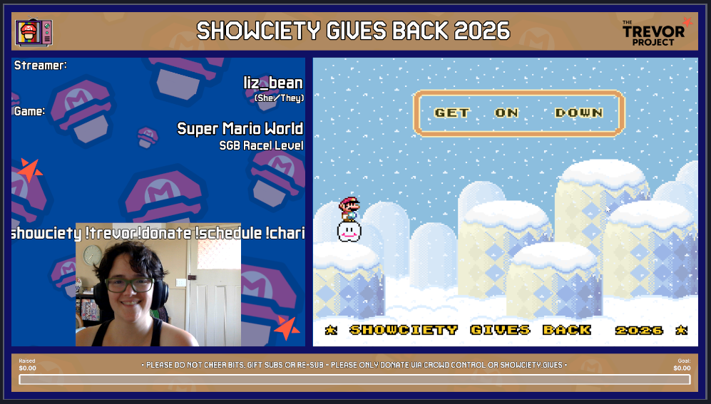
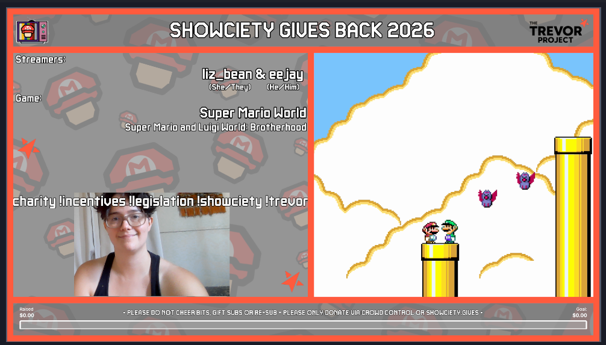
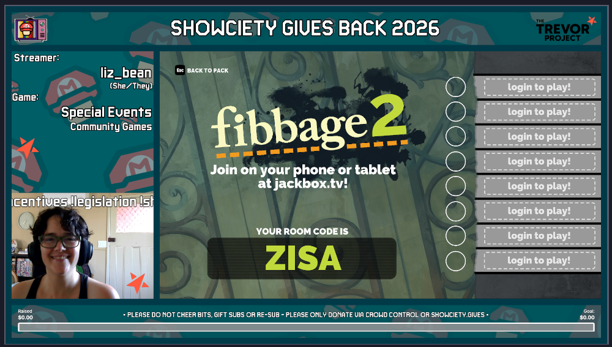

# Streamlabs OBS (SLOBS) Notes

SLOBS does not support importing scene collections so you will need to follow these steps:

1. Install OBS Studio (https://obsproject.com/)
2. Follow the "[Importing Scene Collection](#importing-scene-collection)" and "[Finding Missing Files](#finding-missing-files)" instructions in OBS Studio.
3. Open SLOBS.
4. Click on the down-arrow next to "Scenes" panel heading in the bottom left
5. Click "Manage Scene Collections"
6. In the dialogue that opens click "Import Load existing scenes from OBS" in the top right of the dialogue
7. Wait for it to finish importing and all your scene collections from OBS Studio should be imported! If there is more than one scene collection imported you will need to click on the "SGB26" scene collection under "Your Scene Collections:" on the left of the dialogue.
8. Click "Close" on the "Manage Scene Collections" dialogue and start "[Required Customizations](#required-customizations)"!

Once you have imported into SLOBS you may uninstall OBS Studio if you wish.

# Bot Commands

Please set up the following bot commands. It's recommended to do this shortly before your stream so you don't impact your normal setup. The links in these commands will not show as links on GitHub, but they will in Twitch chat.

* !donate - You may wish to have different donation text depending on if you are using Crowd Control or not. Both are provided here. It is recommended to make !donate or !cc an alias of the other so they both respond with the same text when using Crowd Control. If you are using Crowd Control you should locate your "Interact Link" in the Crowd Control app under "Live" in the bottom left and replace <Interact Link> with it.
  * You can donate to The Trevor Project at showciety.gives
  * You can donate via Crowd Control to The Trevor Project in the Crowd Control extension or here: <Interact Link>
* !schedule - Want to know who's streaming for the charity? You can find the full schedule here! horaro.net/sgb26/main
* !charity - The Trevor Project (thetrevorproject.org) is the world’s largest suicide prevention and mental health organization for lesbian, gay, bisexual, transgender, queer, and questioning (LGBTQ) young people. Your donations have a direct impact on their ability to provide life-saving counseling services to LGBTQ young people.
* !incentives - (list or link to your incentives here - see below for common incentive ideas) (OPTIONAL - remove from Commands text source if you are not using incentives)
* !legislation - The Trevor Project's advocacy programs span the country, and include various types of legislation and education. They have passed 30 bills in the last 10 years, and have fathered 25 different movements, such as "Protecting with Pride".
* !trevor - Did you know that one accepting adult decreases the risk of suicide by 40% for LGBTQ young people. The Trevor Project provides LGBTQ youth with 24/7 crisis counseling via phone, text, and chat. Head to thetrevorproject.org/get-help if you, or anybody you know may need help.
* !showciety - The Super Mario Showciety is a community of Super Mario streamers, builders, viewers, and players! To get involved with the Showciety, check out our Discord discord.gg/skNMmDe and Blue Sky bsky.app/profile/showciety.org Thanks for your support!

# Twitch Panels
There are two options for setting up panels for the event:
## Panel Image
Optionally set up a panel on your Twitch channel to advertise the event and provide a link to the donation page.
   1. Click "Add Image" and upload one of the panel images included
      * `panel_image_blue.png`
	    * 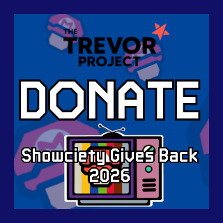
	  * `panel_image_green.png`
	    * 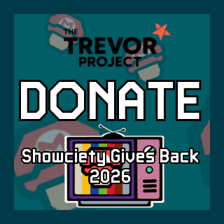
	  * `panel_image_orangegrey.png`
	    * 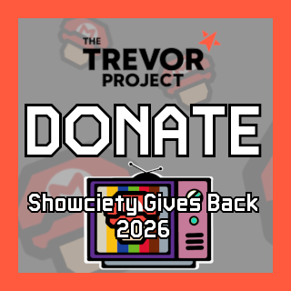
	  * `panel_image_orangeyellow.png`
	    * 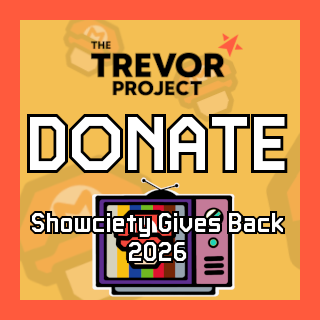
	  * `panel_image_purple.png`
	    * 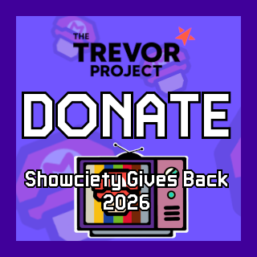
   2. Paste one of three links into the "Image Links To:" box:
      * "https://showciety.gives/" to go directly to our donation page
	  * "https://tiltify.com/+super-mario-showciety/showciety-gives-back-2026" to go to the campaign page
	  * Your Crowd Control "Interact Link". You can get this in the Crowd Control app under "Live" on the bottom left.
   2. Click "Submit"
## Tiltify Extension
Tiltify has great instructions for adding their extension to your panels: https://info.tiltify.com/support/solutions/articles/43000365921-integrating-tiltify-fundraising-extension-on-twitch#Adding-the-Extension-to-your-channel
If you are on the Super Mario Showciety Tiltify team "Showciety Gives Back 2026" will show up in the "Select Campaign" dropdown.

# Talking Points

If your mind blanks while you're live and you need some talking points, we got you. Here are some talking points you can OPTIONALLY bring up to inform people on what the charity does. If people understand that the charity does important work, they will be more likely to donate!

* LGBTQ young people are four times more likely to attempt suicide. Every day, LGBTQ young people reach out for mental health support. When you donate to Trevor, you ensure volunteers can continue to be there for them.
* Trevor provides DIRECT suicide prevention and crisis intervention services to support via phone, text, and chat.
* Trevor fights for policies and laws that protect LGBTQ youth.
* Trevor does research and evaluations that significantly improve their services.
* Trevor provides the world's largest safe-space social networking community.
* Trevor educates and creates public awareness around issues relevant to LGBTQ youth and allies.

# Pre-Charity-Stream Checklist:

Start your stream at least **15 minutes** before your slot is scheduled to begin so that you're ready to go when it's time. Post when you're live in [#sgb26-general](https://discord.com/channels/475693157720522752/1549284734796963910) so a coordinator can check to make sure everything looks and sounds good before the raid.
1. Make sure your overlay looks ok. Power up the game and do a *test recording* or a *test stream* to make sure audio is working properly. You already did this in setup finalization, but it's good to do it again before you're live in case something has changed!
2. Ensure follower/sub only chat is DISABLED so all viewers are allowed to chat.
3. Make sure to REMOVE all donation links that aren't for the charity from your twitch panels and bots (e.g. commands, timers, panels, donation links, etc...).
4. Add Twitch's "Charity" tag to your stream.
5. Keep the [Donations+](https://app.tiltify.com/teams/ffdb1c2d-cc74-4048-95a1-421720155892/campaigns/ed39637d-61c4-40ca-a3e0-00e3644831b4/overview/donations) page open so you can read donations aloud. (**NOTE:** You must have joined the team on Tiltify to see this page!) (**HOT TIP:** This URL can be added as a Custom Browser Dock in OBS Studio, however it doesn't work the best unless you click the "fullscreen" button and is rather large.)
7. Try to accomodate any unexpected issues the best you can.

Stream as you usually would, encouraging donations and talking up the cause (See "Talking Points" if you get stuck). Read out the donation messages as much as you can.

When you have confirmation that the next person on the [schedule](https://horaro.net/sgb26/main) is ready for the switchover, tell your audience what they are in for and then raid into their stream when your time slot is over.

### Please do your absolute best to start and end on time out of respect to the other streamers participating in the event. Nobody wants their time cut short or to have to vamp for extended periods. That being said sometimes there are emergencies outside of your control so try to be accommodating if you can.

### If you are unable to stream for your time slot please let coordinators and your backup streamer know ASAP so they have some time to prepare

# Crowd Control

We only provide limited instructions for setting up Crowd Control, but we are happy to try to help in [#sgb26-troubleshooting](https://discord.com/channels/475693157720522752/1549284772923179128).

## Download The App

Download the app from [Crowd Control's website](https://crowdcontrol.live/). Installation is relatively simple. The hard part is setting up the game.

## Game Setup

Game setup is *the* hardest part of Crowd Control. Crowd Control has instructions for every game they support. You can access the game list [here](https://crowdcontrol.live/games/). Once you have selected your game there should be a link on the left titled "Game Setup Guide". Again, we're happy to try to help in [#sgb26-troubleshooting](https://discord.com/channels/475693157720522752/1549284772923179128) if you are having trouble.

## Crowd Control Overlay

Crowd Control provides a browser source overlay that shows what effects are active and who sent them. It's meant to fit over top of the game. You can configure how it looks in the Crowd Control app including transparencies. We've included pre-sized browser sources for each aspect ratio for you to paste your overlay URL into. It'll need to be done for each aspect ratio since you can only set one size for an individual browser source.

You can find your URL in the Crowd Control app under "Overlay & Assets". Paste it as the URL for one or more of the pre-sized browser sources in their respective scenes:
* Crowd Control 16:9 Overlay Source
* Crowd Control 8:7 Overlay Source
* Crowd Control 4:3 Overlay Source

## Set Up Charity Donations

In the Crowd Control app go to "Config" -> "Charity" and enter our campaign ID, `ed39637d-61c4-40ca-a3e0-00e3644831b4`, into the "Enter Campaign by ID" box and **click the paper airplane button**. It should come up and show our campaign name: "Showciety Gives Back 2026", part of the description of the campaign and a link to the campaign. If this matches please click "Play for this Charity". When you install the extension (should happen automatically) your viewers will now be able to donate for Crowd Control Coins.

**All coins purchased via donation to our Tiltify campaign are shared between all sessions dedicated to that campaign. i.e. Coins purchased by donation during another SGB stream will be usable in your Crowd Control stream for SGB**

## Crowd Control Discord

Crowd Control also has a [Discord server](https://discord.warp.world/) that they also offer help through if we are unable to fix your problem.

# Donation Incentive Ideas

Here are some common donation incentives in no particular order.

* Play a specific game for X minutes (hating the game helps)
* Control Modification
    * Play with controller upside down for X time units
    * Play with Oven Mitts for X time units
    * Play behind the back/head for X time units
    * Play blindfolded for X time units
    * Hands off controller for X time units
    * Change a Keybind for X time units
* Food
    * Hot Peppers
    * Beanboozled
    * Spicy Chips/Confections
    * Food you hate (e.g. pickles)
    * Drink water (laaaaaaaaame :P)
* Clothing
    * Put on a hat
    * Put on a pair of sunglasses
    * Write my name on a T-Shirt
    * Put on another shirt
* Music
    * Karaoke
    * Play me a song
    * Choose a word, improv a song off that
    * Choose an instrument, hear a song
* Body Art
    * Write my name on your arm/face/etc. 
    * Put a sticker on your face/body/etc. 
    * Draw an animal face of donators choice on your arm/face/etc. 
    * Temp Tattoo on face/body/etc.
* Exercise
    * Pushups/Squats/Situps/Burpie/etc. (Can be modified where you do all of them at the end of the stream where $1 = 1 exercise)
* Chat
    * Emote Only for X time units
    * Ban/Timeout Donor/Target for X time units
    * Gift random sub to the community
* Pet
    * Show Pet on Stream
    * Give pet pets
    * Give pet treat
* Social Media
    * Follow Donor on Twitter/Twitch/Youtube
    * Incentives follows (i.e. for every sub on Youtube, the streamer donates $1 to the charity)
    * Shout Donor out on Twitter
	* Channel point rewards that make the streamer donate dollar amounts (e.g. 1000 points for $1 dono, 10000 points for $10 dono)
* Misc
    * Dance 
    * Draw a picture (extra if they choose)
    * Do a Tongue Twister
    * AMA
    * Change your background (green screen) or change your background lighting 
    * Compliment or Roast Donor
    * Tarot Card Reading
    * Dab
    * ASMR
* Swear Jar
* Mario Maker
    * Play My Level (queue skip)
    * Choose my Character 
    * Make a level (choose the theme and idea)
    * Leave an art comment on the level
    * Skip Current Level 
    * Take a Death
* Pokemon
    * Choose my next Pokemon's Name
    * Pokeballs Only
    * No Healing Items for X time
    * Swap Pokemon NOW
    * Use this Move NOW/Next
    * Disable a move for my next battle 
    * Choose a Pokemon I must release
* Music Games (i.e. Dance Dance, osu!, Beat saber 
    * Choose Next Song 
    * Choose a modifier 
    * Minimal Movement 
* FPS
    * Change Weapon
    * Leave Current Game
    * Invert Controls for XX time
    * Adjust Sensitivity
    * Mute your game
    * Drop all your items
* LoL
    * Choose my next champion
    * Choose my lane
    * Choose my skin
* A M O G U S 
    * Choose character color
    * Kill player of donators choice
    * Kill closest player
    * Self report
    * Do something sus (don't talk, talk to much, control the meeting, etc...)
* Goal/Milestone Based (i.e. not single donation, but based on the total)
    * Change into a cosplay 
    * Change into a costume/pj/etc.
    * Dye/Cut Hair
    * Shave Beard/Head
    * Play a Community Game
    * Play a terrible or scary game
    * Cake or Pie to the face
    * Smash an egg on your head/face
    * Costumed Dancing (i.e. Chicken Dance in a Chicken Suit)
    * Get a new Tattoo
    * Do a Bob Ross Tutorial

# Final Notes

If you are having trouble with anything we will do our best to help in the [#sgb26-troubleshooting](https://discord.com/channels/475693157720522752/1549284772923179128).

# Credits

liz_bean - Backgrounds, layouts, design ideas, testing, writing, proofreading, etc...
tehgoocherer - Layouts, design, testing, proofreading, writing, etc...